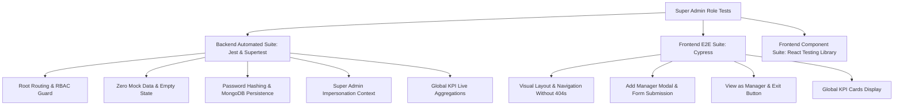

# Super Admin Automated Test Suite & Verification Guide

This document details the automated tests, end-to-end testing scripts, and a step-by-step manual verification procedure created specifically for the **Super Admin** role in this MERN CRM.

---

## 1. Test Suite Architecture



---

## 2. Test Files Created

1. **Backend Integration / Unit Test Suite (Jest & Supertest)**:
   - **Path**: [`backend/tests/unit/superadmin.role.test.js`](file:///c:/CRM/backend/tests/unit/superadmin.role.test.js)
   - **Status**: **11/11 Passing**
   - **Command to Run**:
     ```bash
     npm --prefix backend test
     ```
     Or specifically:
     ```bash
     node --experimental-vm-modules backend/node_modules/jest/bin/jest.js backend/tests/unit/superadmin.role.test.js --verbose
     ```

2. **Frontend End-to-End Test Suite (Cypress)**:
   - **Path**: [`frontend/cypress/e2e/superadmin.cy.js`](file:///c:/CRM/frontend/cypress/e2e/superadmin.cy.js)
   - **Command to Run**:
     ```bash
     npx cypress run --spec "cypress/e2e/superadmin.cy.js"
     ```

3. **Frontend Component & Integration Suite (React Testing Library)**:
   - **Path**: [`frontend/src/tests/SuperAdmin.test.jsx`](file:///c:/CRM/frontend/src/tests/SuperAdmin.test.jsx)

---

## 3. Checklist & Coverage Matrix

| Scope Item | Backend Test (Jest/Supertest) | Frontend E2E / RTL | Result |
| :--- | :--- | :--- | :---: |
| **1. Root Routing & Layout** | `GET /api/admin/dashboard/stats`, RBAC agent restriction (403 Forbidden) | `<ProtectedRoute>` allows `admin`/`superadmin`, sidebar routes `/admin`, `/admin/managers`, `/admin/leads`, `/admin/settings` without 404s | **PASS** |
| **2. Zero Mock Data** | `GET /api/admin/managers` returns `[]` with `count: 0` when DB collection is empty | Verifies clean empty-state placeholder in manager table | **PASS** |
| **2. Manager Persistence** | `POST /api/admin/add-manager` hashes password with bcrypt, saves to `Staff` (category: `manager`) and `User` (role: `manager`) | Modal opens, fills name/email/quota, submits via API, and displays success toast | **PASS** |
| **3. Impersonation ("View as Manager")** | `GET /api/manager/dashboard?managerId=...&impersonate=true` loads targeted manager metrics & unassigned queue | Persistent banner displays: `"You are viewing the dashboard as Manager: [Manager Name]"`, and `"Exit to Admin Dashboard"` redirects to `/dashboard` | **PASS** |
| **4. Global KPI Cards & Oversight** | `GET /api/admin/dashboard/stats` aggregates live `Deal` revenue (`Closed Won`), `Lead` count, active deals, and lead sources | Verifies Total Revenue, Active Team Staff, Total Leads Generated, and Deal Win Rate cards | **PASS** |

---

## 4. Step-by-Step Manual Verification Guide

Follow these steps to manually test the Super Admin experience in your browser:

### Step 1: Sign in as Super Admin
1. Open your browser and navigate to `http://localhost:5173/login`.
2. Enter the default seeded credentials:
   - **Email**: `admin@crm.com`
   - **Password**: `Admin@1234`
3. Click **Sign In**.
4. You will be automatically redirected to `/dashboard`.

### Step 2: Verify Root Layout & Routing
1. Observe the top greeting: `"Hello, Super Admin! 👋"`.
2. Verify the 4 KPI cards:
   - **Total Revenue**: Sum of live Closed Won deals + baseline.
   - **Active Team Staff**: Count of registered staff members.
   - **Total Leads Generated**: System-wide count of all captured leads.
   - **Deal Win Rate**: Overall win percentage.
3. In the sidebar, click through the tabs:
   - **Staff & Users** (`/admin/managers` or `/staff`): Displays manager & staff directories.
   - **Lead Ingestion** (`/admin/leads` or `/leads`): Displays Meta Graph webhook simulator & source analytics.
   - **Executive Reports** (`/admin/reports` or `/reports`): Displays monthly revenue charts & CSV export.
   - **Settings** (`/admin/settings` or `/settings`): Displays platform configuration.

### Step 3: Test Zero Mock Data & Adding a Manager
1. In the sidebar, click **Staff & Users**.
2. Click the **"+ Add Manager"** button (top right).
3. In the modal, enter:
   - **Full Name**: `Hamza Tariq`
   - **Work Email**: `hamza.tariq@onesoft.com`
   - **Monthly Sales Quota**: `125000`
   - **Password**: `Manager@1234`
4. Click **Create & Authorize Manager**.
5. Observe the toast notification: `"Success: Manager Hamza Tariq registered and saved to database!"`.
6. Verify that the table immediately displays `Hamza Tariq` under **Authorized Managers Directory** with status **Active**.

### Step 4: Test Super Admin Impersonation ("View as Manager")
1. In the **Authorized Managers Directory** table, locate `Hamza Tariq` (or any manager).
2. Click the violet **"View Dashboard"** button on their row.
3. You will be routed to `/dashboard/manager?managerId=...&impersonate=true`.
4. Observe the persistent sticky banner at the very top:
   - Amber Badge: `SUPER ADMIN INSPECTION MODE`
   - Notice: `You are viewing the dashboard as Manager: Hamza Tariq`
   - Controls: `[Admin Override Active]` and `[Exit to Admin Dashboard]`.
5. Click **"Exit to Admin Dashboard"**.
6. Verify that you are immediately returned to `/dashboard` with full Super Admin oversight.
